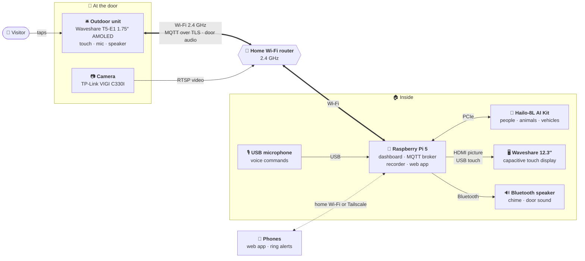

# 🔔 Smart Doorbell

**A round touch-screen doorbell at the door, and a wall dashboard inside that rings, shows who is there,
records every visit and spots people, animals and vehicles on its own AI chip.**

<table>
<tr>
<td width="62%"></td>
<td width="38%"></td>
</tr>
<tr>
<td align="center"><b>Indoor</b> — Raspberry Pi 5 on a 12.3″ touch display</td>
<td align="center"><b>Outdoor</b> — 1.75″ round AMOLED on a Tuya T5</td>
</tr>
</table>

---

## ✨ What it does

| | |
|---|---|
| 🔔 **Ring** | Tap the round screen at the door: the bell swings, the chime plays inside on a Bluetooth speaker and the wall shows the door camera with a big **STOP** |
| 📷 **See and hear** | The **Front door** view shows the camera live with the doorbell's own microphone, in sync with the picture; red boxes mark people, animals and vehicles |
| 🎬 **Record** | Every ring is saved from before the press; people, animals and vehicles that **move** in view are recorded too (5 s before to 55 s after). Leaves, shadows and insects are ignored |
| 🧠 **On-device AI** | Detection runs on a Hailo-8L AI chip in the Pi: 30 frames a second, no cloud, almost no CPU |
| 🖥️ **A beautiful wall screen** | Four looks drawn on the GPU — *Editorial*, *Paper*, *Glass*, *Fluent* — with live news, markets and photos when nobody is at the door |
| 📱 **Phones** | The whole dashboard as a web app, and ring alerts with **Stop the bell** even when the page is closed (Android and iPhone) |
| 🎙️ **Voice** | *"Stop the bell"*, *"Show events from yesterday"* — understood on the Pi itself |
| 🩺 **Peace of mind** | A phone alert when the doorbell goes offline; an encrypted link between the two units; nothing leaves your home network |

---

## 🗺️ The setup

The doorbell and the Pi meet on your home Wi-Fi (the doorbell is 2.4 GHz only). The Pi runs the MQTT broker the
doorbell talks to, reads the camera over RTSP and serves the web app — no cloud account anywhere.
More on each part: **[Hardware](docs/hardware.md)**.

---

## 🧰 What you need

| Part | Model used here | Role |
|---|---|---|
| Doorbell board | [Waveshare T5-E1 Touch AMOLED 1.75″](https://www.waveshare.com/t5-e1-touch-amoled-1.75.htm) | Round touch screen, mic and speaker at the door |
| Indoor computer | Raspberry Pi 5 (Raspberry Pi OS desktop) | Dashboard, MQTT broker, recorder, web app |
| AI accelerator | Raspberry Pi AI Kit (Hailo-8L) | Person / animal / vehicle detection |
| Display | [Waveshare 12.3″ capacitive touch display](https://www.waveshare.com/12.3inch-hdmi-lcd.htm) (HDMI + USB touch) | The wall screen |
| Camera | TP-Link VIGI C330I (any RTSP camera works) | Live view and recordings |
| Speaker | Any Bluetooth speaker | Chime and the door's sound |
| Microphone | Any USB microphone (optional) | Voice commands |

---

## 🚀 Quick start

1. **Doorbell** (on a Windows PC): `.\setup.cmd`, then `.\build.cmd -Flash COM6`.
2. **Raspberry Pi**: `bash smart-door-bell/Indoor/setup_pi.sh`.
3. **Connect them**: on the doorbell hold the screen 5 s → **Wi-Fi**, then **Indoor Unit → Set address** to the Pi's IP.

Step by step, with the camera, speaker, encryption and phones: **[Setup guide](docs/setup.md)**.

---

## 📚 Documentation

| | |
|---|---|
| 🛎️ **[Outdoor unit](docs/outdoor.md)** | The round screen: bell styles, sound, Wi-Fi on the screen, night mode, settings |
| 🖥️ **[Indoor dashboard](docs/indoor.md)** | The four looks, the visitor screen, voice, speaker and tones, festival themes |
| 🎬 **[Recordings & detection](docs/recordings.md)** | Ring and motion recordings, the AI detector, door sound in sync, storage |
| 📱 **[Phones & web](docs/phones.md)** | The web app, ring alerts, offline alerts, ntfy, Tailscale |
| 🔧 **[Hardware](docs/hardware.md)** | Boards, display, camera, wiring and network |
| 🚀 **[Setup guide](docs/setup.md)** | Build, flash, install, connect, encrypt |
| 📖 **[Reference](docs/reference.md)** | How a ring flows, MQTT topics, security, project layout |

Deeper notes: [Outdoor/README.md](Outdoor/README.md) (firmware build and board configuration) ·
[Indoor/README.md](Indoor/README.md) (the Pi side by hand) · [Indoor/topics.md](Indoor/topics.md) (MQTT payloads).

---

## 🙏 Credits

Built on [TuyaOpen](https://github.com/tuya/TuyaOpen) and [LVGL](https://lvgl.io) ·
dashboard in [PySide6 / Qt Quick](https://doc.qt.io/qtforpython-6/) ·
detection with [Hailo](https://hailo.ai) and YOLOv8 from Raspberry Pi's `hailo-models` ·
type: [Inter](https://rsms.me/inter/) and [EB Garamond](https://github.com/octaviopardo/EBGaramond12) ·
landscape photos from [Unsplash](https://unsplash.com) via [Lorem Picsum](https://picsum.photos) — photographers in
[Indoor/assets/scenic/CREDITS.md](Indoor/assets/scenic/CREDITS.md) ·
headlines from the channels' public RSS feeds and [Google News](https://news.google.com).
