

# 🔔 Smart Video Door Bell

**A completely DIY video doorbell : open hardware and open software, built end to end at home.**

## 🛠️ A completely DIY project

Everything in this doorbell was chosen, assembled and written by hand: selecting the boards, display, camera and AI
accelerator, wiring and connecting them, and every line of software: the round touch screen at the door, the wall
dashboard inside, the AI recorder, the web app and phone alerts.

**Why I built it:** a doorbell bought off the shelf does what its maker decided, in their app and their cloud.
Building it myself gives me the **freedom to customise every feature** : how it looks and sounds, what it records,
where the videos are kept, how it alerts me : and a platform for my own **AI-based developments**, like teaching it
to record only people, animals and vehicles. Nothing is locked, nothing leaves the home network unless I want it to.

Think of it as **open hardware and open software**: off-the-shelf parts anyone can buy, open-source firmware and
software anyone can read, change and build on.

---

## 🗺️ The setup

<table>
<tr>
<td width="62%"></td>
<td width="38%"></td>
</tr>
<tr>
<td align="center"><b>Indoor unit</b> : Raspberry Pi 5 + Hailo-8L AI on a 12.3″ touch display</td>
<td align="center"><b>Outdoor unit</b> : 1.75″ round touch AMOLED on a Tuya T5</td>
</tr>
</table>

The doorbell and the Pi meet on the home Wi-Fi (the doorbell is 2.4 GHz only). The Pi runs the MQTT broker the
doorbell talks to, reads the camera over RTSP, runs the AI on the Hailo and serves the web app : no cloud account
anywhere. More: **[Hardware](docs/hardware.md)**.

---

## ✨ Features

### 1. 🖥️ Indoor unit display

#### A dashboard on the wall

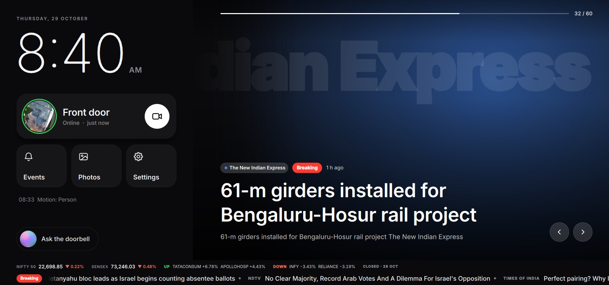

When nobody is at the door the wall shows a calm home screen, drawn on the Pi's GPU with Qt Quick:

- 🕒 **Clock and date**, large
- 🚪 **Front door** : the camera's latest picture (refreshed every minute) and whether the doorbell is online; one
  tap opens the live camera
- ▶️ **Events** · 🏞️ **Photos** · ⚙️ **Settings** : one tap each
- 📰 **News like a TV channel** : top stories from NDTV, Times of India, BBC, Yahoo News and Google News with photo
  and summary, a **breaking-news** ticker and banner
- 📈 **Markets** : NIFTY 50, SENSEX and the day's top gainers and losers
- 🏞️ **Photo slideshow** with a slow Ken Burns drift, instead of the news
- 🎙️ **"Ask the doorbell"** : offline voice commands: *"Stop the bell"*, *"Show events from yesterday"*,
  *"Play the last recording"*
- 🎨 **Four looks** : *Editorial*, *Paper*, *Glass*, *Fluent*

#### Front door camera

<table>
<tr>
<td width="62%">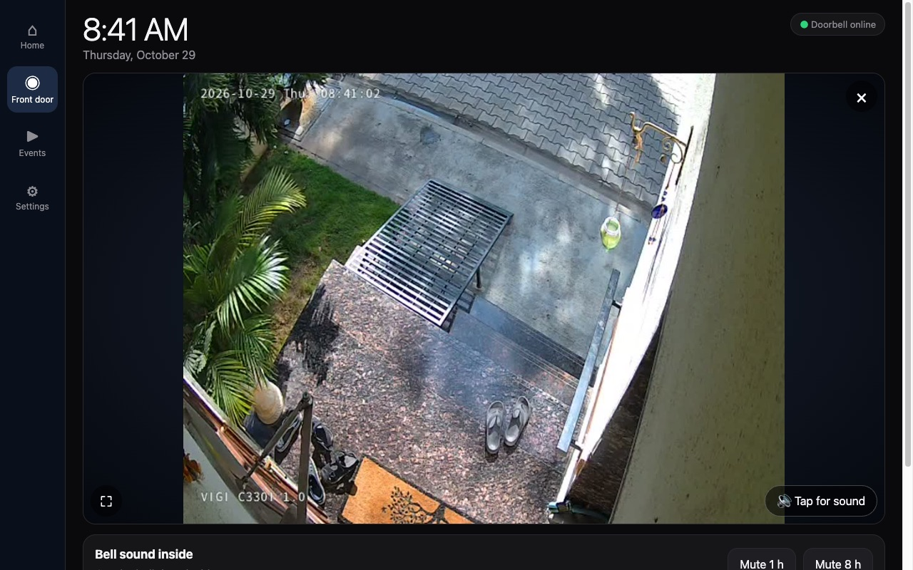</td>
<td width="38%">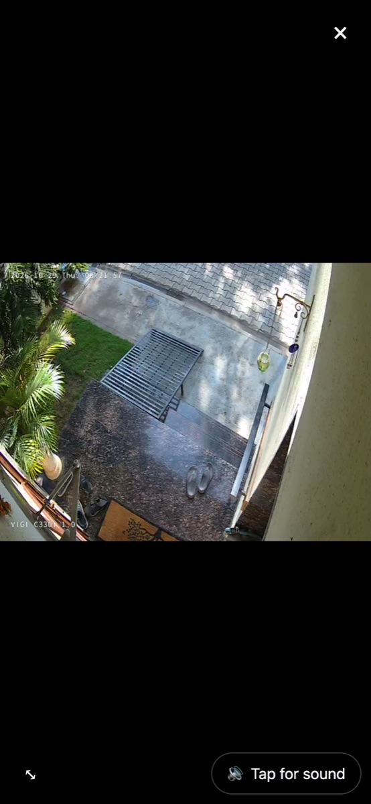</td>
</tr>
<tr>
<td align="center">Live picture <b>and sound</b> from the door, any time</td>
<td align="center"><b>Full screen</b> on a phone</td>
</tr>
</table>

- 📷 **Live view** with the doorbell's microphone, delayed to match the picture
- ⛶ **Full screen** : the browser's own full screen (turned to landscape where the phone allows), or the picture
  filling the window on iPhone
- 🚨 **When someone rings** the wall becomes the door: *VISITOR AT THE DOOR*, the camera full screen like a video
  call, a countdown and a big **STOP** that also returns the doorbell to its main screen
- 🔇 **Mute the bell** for 1 or 8 hours · 🗣️ **talk to the visitor** (trial)

#### Events

<table>
<tr>
<td width="68%">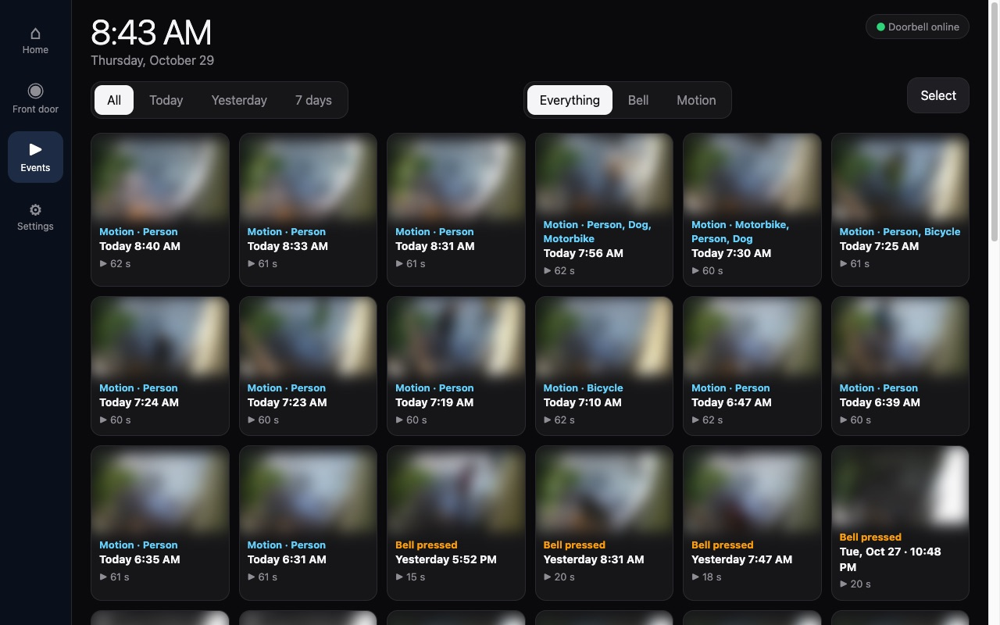</td>
<td width="32%">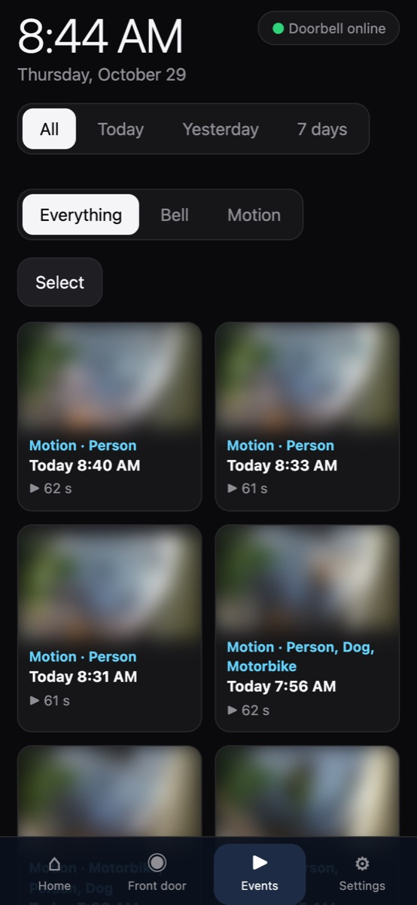</td>
</tr>
<tr>
<td colspan="2" align="center">Every ring and movement, labelled with what the AI saw (thumbnails blurred here for privacy)</td>
</tr>
</table>

- 🗂️ Filters: **All / Today / Yesterday / 7 days** and **Everything / Bell / Motion**
- ▶️ Tap to play, with sound; **select** and delete one or many
- 💾 When the SD card runs low, the **oldest motion clips make room first**; rings are kept longest

#### AI-based recording when motion is detected

The Pi carries a **[Raspberry Pi AI Kit](https://www.raspberrypi.com/products/ai-kit/)**: a **Hailo-8L** neural-network
accelerator (13 TOPS) on the Pi 5's PCIe connector. It runs **YOLOv8s** on the door camera in about **33 ms a
frame**, watching the door around the clock while the Pi's CPU stays free for everything else.

**Only a person, an animal or a vehicle that moves starts a recording.** Insects, leaves, swaying trees, rain,
shadows and headlight sweeps never do.

| Seen by the camera | Recorded? |
|---|---|
| 🚶 A person walking up the path | ✅ yes |
| 🐕 A dog or cat crossing the drive | ✅ yes |
| 🚗 A car or motorbike driving in | ✅ yes |
| 🍃 Leaves, branches and trees moving in the wind | ❌ never : not a person, animal or vehicle |
| 🦟 Insects on the lens, rain, shadows, headlight sweeps | ❌ never |
| 🛵 A car or scooter parked in view | ❌ no : present, but not moving |

🎬 **Video with audio.** Every recording : ring or motion : has the **doorbell's own microphone**, lined up with the
picture sample by sample. Recordings start **before** the event: 3 s before a bell press, 5 s before a movement.

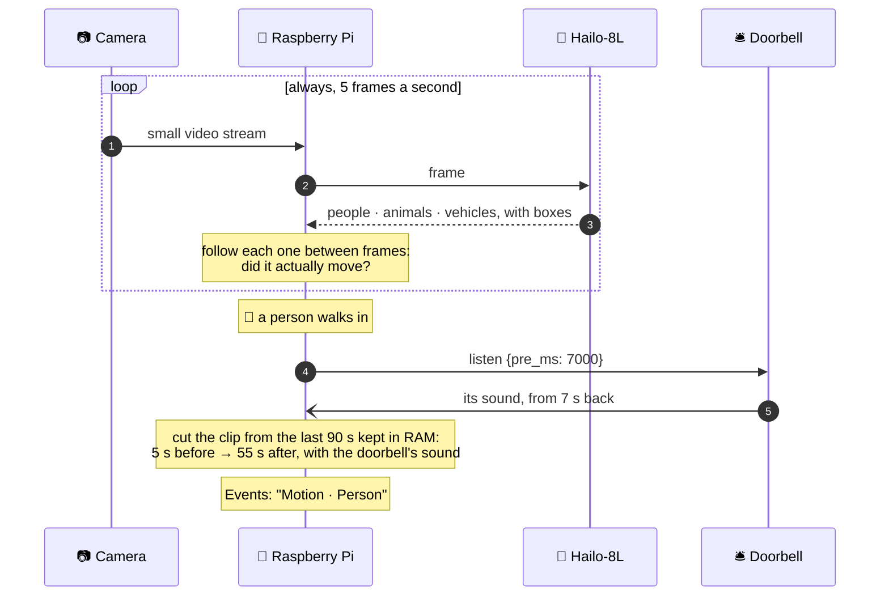

Details: **[Recordings & detection](docs/recordings.md)**.

#### Settings

Everything is set from the **Settings** page : on the wall, or in the web app on a phone or laptop:

| Section | What it controls |
|---|---|
| **Look** | The four home-screen looks, with previews; every page takes its colours |
| **Speaker** | Search, pair, connect and forget Bluetooth speakers, volume, test sound, two-way talk (trial) |
| **Bell tone** | 16 original tones : chimes, Bollywood style, festive and funny : previewed on the phone or the speaker, or your own |
| **News** | Channels (NDTV, Times of India, BBC, The Hindu, Hindustan Times, Yahoo, Google News), Google News regions and topics |
| **Festivals** | Automatic Diwali, Christmas and New Year themes and tones on both units, the coming dates, try one for a minute |
| **Phone (ntfy)** | Phone notifications through ntfy, and the alert when the doorbell is offline |
| **Camera** | Find, log in and test the camera; recording length after a press, sound in recordings, motion recording on or off |
| **Web access & alerts** | The web app's password and address, ring alerts on this device |
| **Outdoor unit** | Everything on the doorbell at the door : see *Outdoor unit settings* below |

<table>
<tr>
<td width="50%">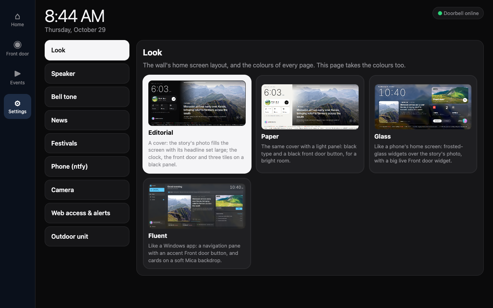</td>
<td width="50%"></td>
</tr>
<tr><td align="center"><b>Look</b></td><td align="center"><b>Bell tone</b></td></tr>
<tr>
<td></td>
<td></td>
</tr>
<tr><td align="center"><b>Speaker</b></td><td align="center"><b>News</b></td></tr>
<tr>
<td>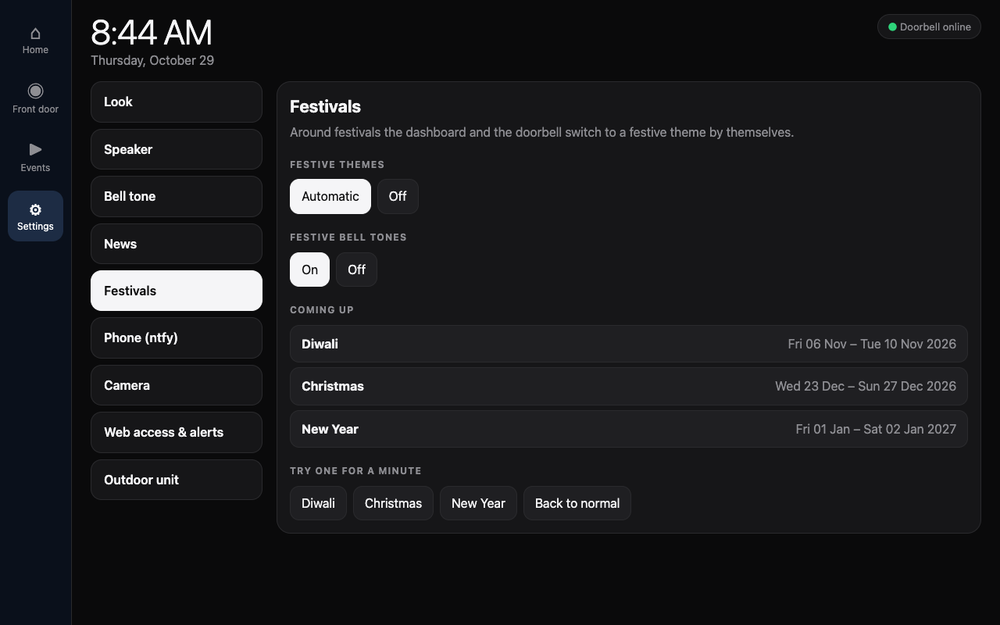</td>
<td>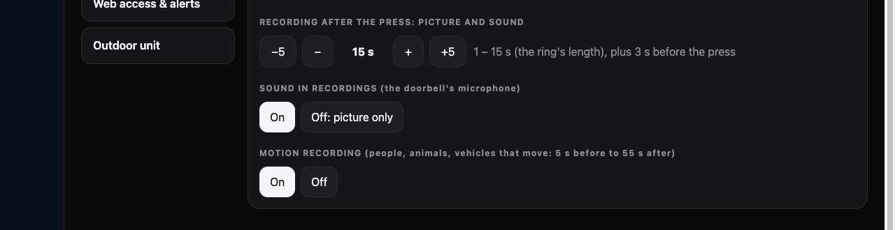</td>
</tr>
<tr><td align="center"><b>Festivals</b></td><td align="center"><b>Recording</b> (in Camera)</td></tr>
</table>

More: **[Indoor dashboard](docs/indoor.md)** · **[Phones & web](docs/phones.md)**

---

### 2. 🛎️ Outdoor unit display

<b>Classic bell</b> · <b>Push button</b> (a pulsing halo invites a tap) · <b>Ringing</b> (Midnight &amp; Gold)

- 👆 **Touch-based doorbell** : a tap on the round 1.75″ AMOLED rings inside; the bell swings with pulsing sound
  waves and a chime plays at the door so the visitor knows it rang
- 📨 **Reliable rings** : every press is acknowledged by the Pi and resent until it is, never a double ring
- 🎙️ **Its own microphone** : keeps the last 8 s of sound, so recordings start before the press
- 🎨 **Themes** : *Clean & Light* or *Midnight & Gold* (true black, kind to AMOLED), six bell styles, four bell
  colours and an optional *aurora* glow; Diwali, Christmas and New Year themes by themselves
- 🌙 **Blank at night** : the screen turns off from **11 pm to 6 am** by default (the hours can be changed, or it can
  stay lit); a touch lights it for 30 s without ringing, and a ring always lights it
- 🕒 **Network clock** · 💾 settings survive restarts

#### Outdoor unit settings

The doorbell is configured from **Settings → Outdoor unit** on the wall or a phone : nothing needs doing at the door:

| Tab | What you can change |
|---|---|
| **Look** | Theme (*Clean & Light*, *Midnight & Gold*), bell colour (blue, gold, silver, red), bell style (*Classic*, *Push button*, *Temple*, *Hand bell*, *Twin bells*, *Flat*), background glow |
| **Sound** | Chime (*Ding Dong*, *Westminster*, *Triple Chime*, *Marimba*, *Church Bell*), once per press or for the whole ring, volume (quiet, normal, loud), ring duration (10 – 60 s) |
| **Screen** | Screen off at night on or off, from and until which hour, and turn the screen on or off right now |
| **Network** | Move the doorbell to another Wi-Fi network, or change the indoor unit's address : kept only if the doorbell reaches the Pi within 60 s, so a typo cannot strand it |

<table>
<tr>
<td width="33%"></td>
<td width="33%">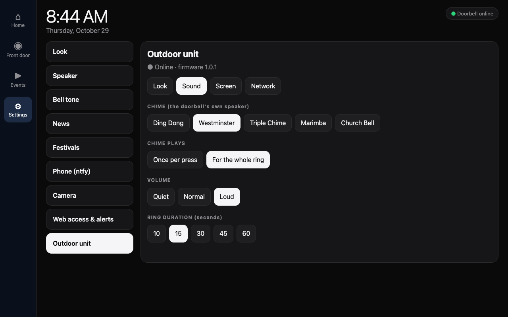</td>
<td width="33%">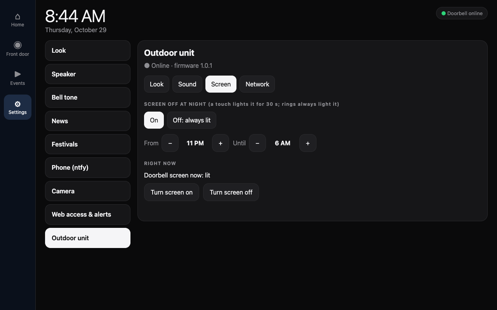</td>
</tr>
<tr><td align="center"><b>Look</b></td><td align="center"><b>Sound</b></td><td align="center"><b>Screen</b></td></tr>
</table>

On the doorbell itself there is a setup screen for the first start: scan for **Wi-Fi**, type the password on a
keyboard sized for the round screen, enter the **indoor unit's address**, and pick a bell from thumbnails drawn in
its colour. A wrong Wi-Fi password never loses the network that worked.

More: **[Outdoor unit](docs/outdoor.md)**

 

---

### 📱 On your phone

The whole dashboard is also a **web app** : news, the live door with sound and full screen, the events, every
setting : at home or from anywhere over **Tailscale**. **Ring alerts** arrive even with the page closed, with the
visitor's picture and a **Stop the bell** button (Android and iPhone), plus **ntfy** notifications and an alert when
the doorbell goes offline. More: **[Phones & web](docs/phones.md)**

### 🧭 How a ring works

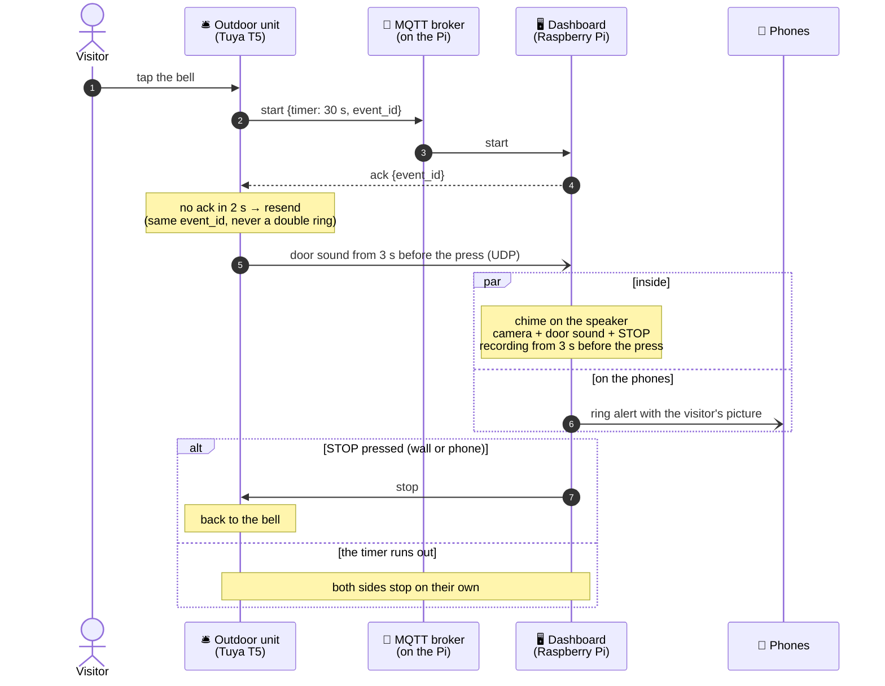

---

## 🧰 Hardware used

| Part | Model used here | Role |
|---|---|---|
| Doorbell board | [Waveshare T5-E1 Touch AMOLED 1.75″](https://www.waveshare.com/t5-e1-touch-amoled-1.75.htm) (Tuya T5, 466 × 466 round AMOLED, touch, mic, speaker) | The outdoor unit at the door |
| Indoor computer | Raspberry Pi 5 (Raspberry Pi OS desktop) | Dashboard, MQTT broker, recorder, web app |
| AI accelerator | [Raspberry Pi AI Kit](https://www.raspberrypi.com/products/ai-kit/) (Hailo-8L, 13 TOPS, M.2 over PCIe) | Person / animal / vehicle detection |
| Display | [Waveshare 12.3″ capacitive touch display](https://www.waveshare.com/12.3inch-hdmi-lcd.htm) (HDMI + USB touch) | The wall screen |
| Camera | TP-Link VIGI C330I (any RTSP camera works) | Live view and recordings |
| Speaker | Any Bluetooth speaker (here a Philips BT100) | Chime and the door's sound |
| Microphone | Any USB microphone (optional) | Voice commands |
| Network | The home Wi-Fi router (2.4 GHz for the doorbell) | Connects everything; Tailscale for phones away from home |

Wiring, power and network details: **[Hardware](docs/hardware.md)**.

---

## 🚀 Quick start

1. **Doorbell** (Windows PC): `.\setup.cmd`, then `.\build.cmd -Flash COM6`.
2. **Raspberry Pi**: `bash smart-door-bell/Indoor/setup_pi.sh`.
3. **Connect them**: join the doorbell to your 2.4 GHz Wi-Fi and give it the Pi's address on its setup screen :
   from then on it is configured from the dashboard.

Step by step, with the camera, speaker, encryption and phones: **[Setup guide](docs/setup.md)**.

---

## 📚 Documentation

| | |
|---|---|
| 🎬 **[Recordings & detection](docs/recordings.md)** | AI-triggered recording, the Hailo detector, sound in sync, storage |
| 🛎️ **[Outdoor unit](docs/outdoor.md)** | The round screen, its looks and sounds, configuring it from the wall |
| 🖥️ **[Indoor dashboard](docs/indoor.md)** | The four looks, the visitor screen, voice, tones, festival themes |
| 📱 **[Phones & web](docs/phones.md)** | The web app, ring alerts, offline alerts, ntfy, Tailscale |
| 🔧 **[Hardware](docs/hardware.md)** | Boards, the Hailo, display, camera, wiring and network |
| 🚀 **[Setup guide](docs/setup.md)** | Build, flash, install, connect, encrypt |
| 📖 **[Reference](docs/reference.md)** | MQTT topics, security, project layout |

---

## 🙏 Credits

Built on [TuyaOpen](https://github.com/tuya/TuyaOpen) and [LVGL](https://lvgl.io) ·
dashboard in [PySide6 / Qt Quick](https://doc.qt.io/qtforpython-6/) ·
detection with [Hailo](https://hailo.ai) and YOLOv8 from Raspberry Pi's `hailo-models` ·
type: [Inter](https://rsms.me/inter/) and [EB Garamond](https://github.com/octaviopardo/EBGaramond12) ·
landscape photos from [Unsplash](https://unsplash.com) via [Lorem Picsum](https://picsum.photos) : photographers in
[Indoor/assets/scenic/CREDITS.md](Indoor/assets/scenic/CREDITS.md) ·
headlines from the channels' public RSS feeds and [Google News](https://news.google.com).
