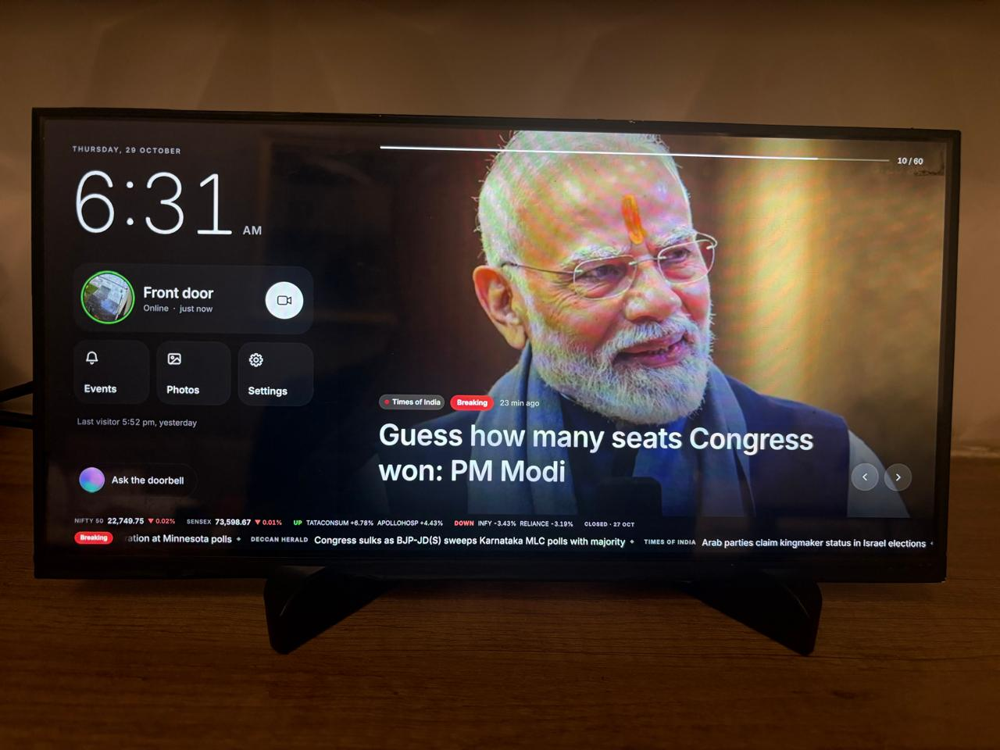
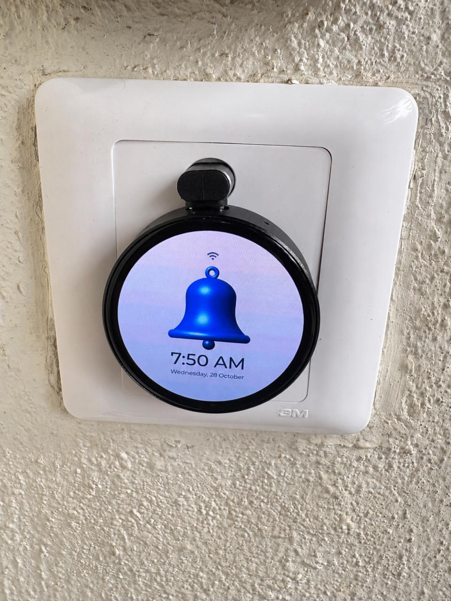
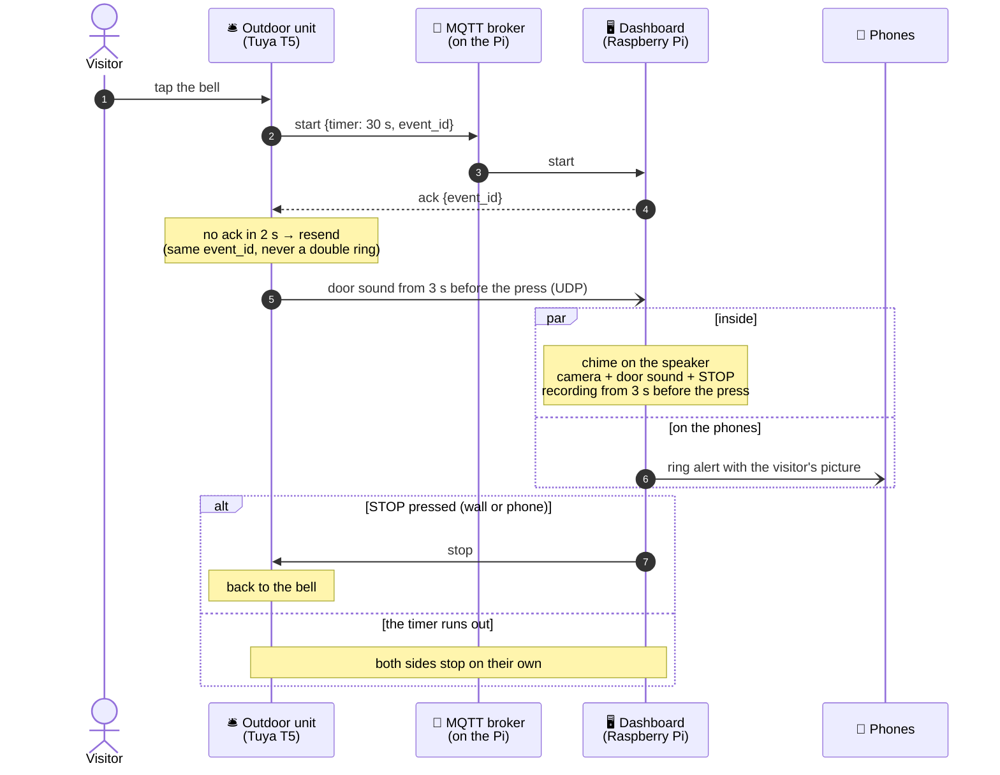
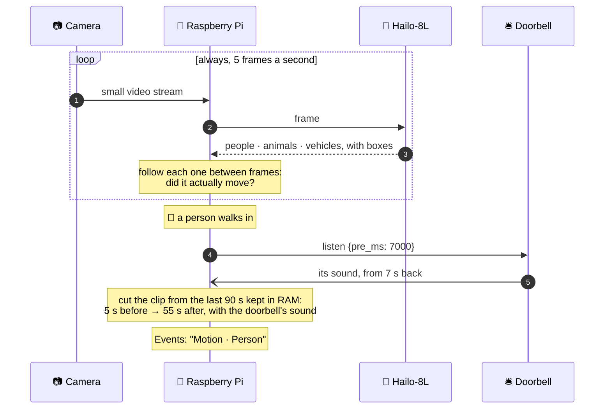
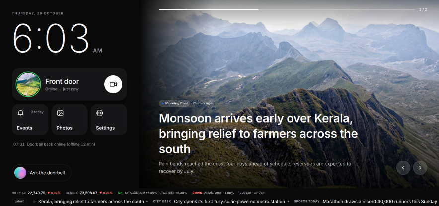
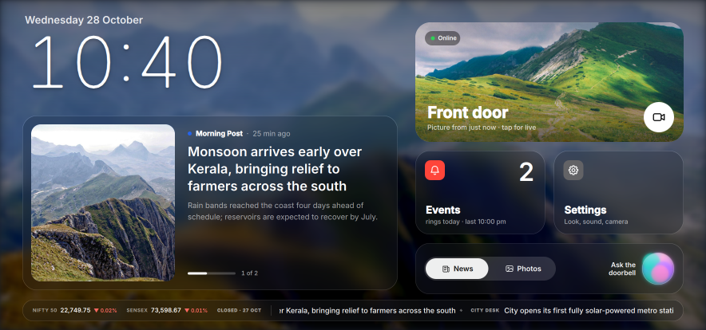
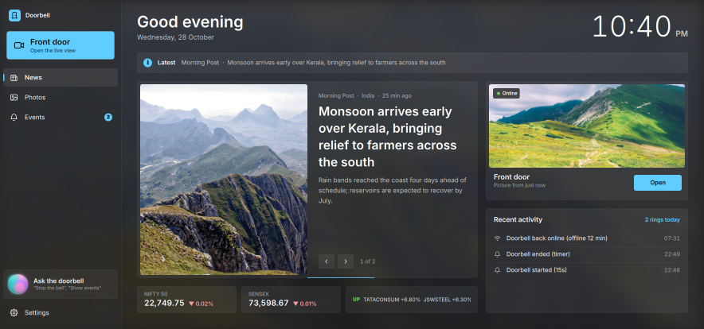
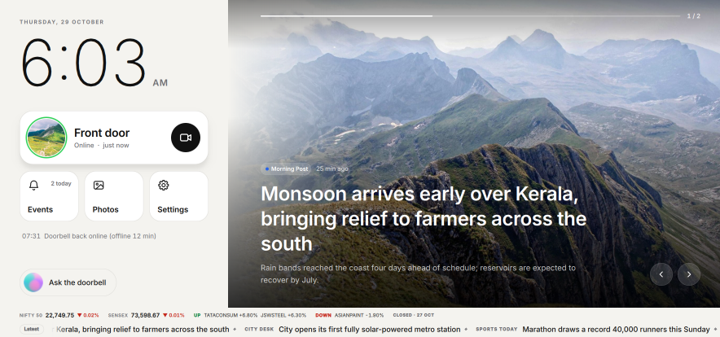

# 🔔 Smart Doorbell

**A round touch-screen doorbell at the door, and a wall dashboard inside that rings, shows and lets you hear who is
there, and records every visit — with an on-device AI that tells people, animals and vehicles from leaves and insects.**

<table>
<tr>
<td width="62%"></td>
<td width="38%"></td>
</tr>
<tr>
<td align="center"><b>Indoor</b> — Raspberry Pi 5 + Hailo-8L on a 12.3″ touch display</td>
<td align="center"><b>Outdoor</b> — 1.75″ round AMOLED on a Tuya T5</td>
</tr>
</table>

---

## ✨ Highlights

| | |
|---|---|
| 🧠 **AI-triggered recording** | A **Hailo-8L** AI accelerator watches the door around the clock. Only a **person, animal or vehicle that moves** starts a recording — never swaying leaves, shadows, rain or insects |
| 🎬 **Every visit on video, with sound** | Rings and movements are recorded from **before** they happen (3 s before a press, 5 s before a movement) with the **doorbell's own microphone**, in sync with the picture |
| 🔔 **Ring** | Tap the round screen: the bell swings, a chime plays inside on a Bluetooth speaker and the wall shows the door camera with a big **STOP** |
| 📷 **See and hear the door** | The **Front door** view: live camera, live sound, and red boxes around the people, animals and vehicles the AI sees |
| 🎛️ **Doorbell set up from the wall** | Theme, bell, chime, volume, ring time, night screen, Wi-Fi and more — all changed from the dashboard, nothing to do at the door |
| 🖥️ **A beautiful wall screen** | Four looks drawn on the GPU — *Editorial*, *Paper*, *Glass*, *Fluent* — with live news, markets and photos between visitors |
| 📱 **Phones** | The whole dashboard as a web app, and ring alerts with the visitor's picture and **Stop the bell** — even with the page closed |
| 🎙️ **Voice** | *"Stop the bell"*, *"Show events from yesterday"*, *"Play the last recording"* — understood on the Pi, offline |
| 🩺 **Peace of mind** | An alert when the doorbell goes offline · an encrypted link between the units · nothing leaves your home network |

---

## 🗺️ The setup

The doorbell and the Pi meet on your home Wi-Fi (the doorbell is 2.4 GHz only). The Pi runs the MQTT broker the
doorbell talks to, reads the camera over RTSP, runs the AI on the Hailo and serves the web app — no cloud account
anywhere. More: **[Hardware](docs/hardware.md)**.

---

## 🧭 How a ring works

---

## 🧠 AI recording — only what matters

The Pi carries a **[Raspberry Pi AI Kit](https://www.raspberrypi.com/products/ai-kit/)**: a **Hailo-8L** neural-network
accelerator on the Pi 5's PCIe connector. It runs **YOLOv8s** on the door camera in about **33 ms a frame** —
fast enough to watch the door continuously while the Pi's own CPU stays free for everything else.

| Hailo-8L | |
|---|---|
| **Performance** | 13 TOPS, on an M.2 module attached over PCIe |
| **Model used** | YOLOv8s, 640 × 640, trained on COCO's 80 everyday objects — from Raspberry Pi's `hailo-models` |
| **Speed here** | ~33 ms a frame (~30 fps), detection and filtering on the chip |
| **Also ready on the chip** | pose estimation, instance segmentation, face detection, image classification — models already installed |

**What starts a recording — and what doesn't:**

| Seen by the camera | Recorded? |
|---|---|
| 🚶 A person walking up the path | ✅ yes |
| 🐕 A dog or cat crossing the drive | ✅ yes |
| 🚗 A car or motorbike driving in | ✅ yes |
| 🍃 Leaves and branches moving in the wind | ❌ never — not a person, animal or vehicle |
| 🦟 Insects on the lens, rain, shadows, headlight sweeps | ❌ never |
| 🛵 A car or scooter parked in view | ❌ no — present, but not moving |

Every recording — ring or motion — keeps the **doorbell's own microphone**, lined up with the picture sample by
sample. The **Events** page labels each one *Bell pressed* or *Motion · Person, Car*, with **All / Bell / Motion**
filters. When the SD card runs low, the **oldest motion clips make room first**; rings are kept longest.
Details: **[Recordings & detection](docs/recordings.md)**.

---

## 🛎️ Outdoor unit

<b>Classic bell</b> · <b>Push button</b> (a pulsing halo invites a tap) · <b>Ringing</b> (Midnight &amp; Gold)

- 🔔 **Tap to ring** — the bell swings with pulsing sound waves, drawn at full resolution on the 466 × 466 AMOLED
- 🛎️ **Six bell styles** — *Classic*, *Push button*, *Temple*, *Hand bell*, *Twin bells*, *Flat* — in four colours
- 🎨 **Two themes** — *Clean & Light* or *Midnight & Gold* (true black), with a soft **aurora glow** behind the bell
- 🔊 **A chime at the door** — five chimes, once or for the whole ring, three volumes
- 🎙️ **Its microphone** — keeps the last 8 s of sound, so recordings start before the press
- 🌙 **Screen off at night** — dark from 11 pm to 6 am by default; a touch or a ring lights it
- 🕒 **Network clock** · 📨 **reliable rings** (acknowledged and resent) · 💾 **settings survive restarts**
- 🎛️ **Configured from the wall** — **Settings → Outdoor unit** on the dashboard changes the theme, bell style and
  colour, aurora, chime, volume, ring duration, night hours, and even moves the doorbell to another Wi-Fi network
  (it keeps the new one only if it reaches the Pi within 60 s, so a typo cannot strand it)

More: **[Outdoor unit](docs/outdoor.md)** · hardware: **[Waveshare T5-E1 Touch AMOLED 1.75″](docs/hardware.md)**

---

## 🖥️ Indoor dashboard

<table>
<tr>
<td width="50%"></td>
<td width="50%"></td>
</tr>
<tr>
<td align="center"><b>Editorial</b> — the story full-bleed beside a quiet black panel</td>
<td align="center"><b>Glass</b> — frosted widgets, like a phone's home screen</td>
</tr>
<tr>
<td></td>
<td></td>
</tr>
<tr>
<td align="center"><b>Fluent</b> — navigation pane and cards, like a Windows app</td>
<td align="center"><b>Paper</b> — light panel, black type, for a bright room</td>
</tr>
</table>

- 🎨 **Drawn on the GPU** with Qt Quick — real frosted-glass blur, soft shadows, smooth motion
- 🚪 **Front door, always first** — the camera's latest picture, refreshed every minute, and whether the doorbell is online
- 🚨 **Visitor screen** — the camera full screen like a video call, the door's sound, a countdown and a big **STOP**
- 📰 **News** — NDTV, Times of India, BBC, Yahoo News, Google News by region and topic, with a breaking-news ticker
  and banner · 📈 **NIFTY 50 and SENSEX** · 🏞️ **photo slideshow** with a slow Ken Burns drift
- 🔊 **16 ring tones** on a Bluetooth speaker — chimes, Bollywood style, festive and funny — or your own
- 🎙️ **Voice commands** — on the Pi, with Whisper; the orb on the home screen lights up while it listens
- 🗣️ **Talk to the visitor** (trial) — two-way audio through the doorbell
- 🪔 **Festival themes** — Diwali sparks, Christmas snow, New Year confetti, on both units, by themselves
- 🚀 **Starts at boot**, restarts itself if it ever stops

More: **[Indoor dashboard](docs/indoor.md)**

---

## 📱 On your phone

- 💻 **The whole dashboard as a web app** — news, live door with sound, recordings with filters, every setting
- 🔔 **Ring alerts without an app** — the visitor's picture, **Stop the bell**, a tap to see the door (Android and iPhone)
- 📨 **ntfy notifications** · 🩺 **doorbell-offline alert** with how long it was down
- 🌍 **From anywhere** with Tailscale; nothing exposed to the internet

More: **[Phones & web](docs/phones.md)**

---

## 🧰 What you need

| Part | Model used here | Role |
|---|---|---|
| Doorbell board | [Waveshare T5-E1 Touch AMOLED 1.75″](https://www.waveshare.com/t5-e1-touch-amoled-1.75.htm) | Round touch screen, mic and speaker at the door |
| Indoor computer | Raspberry Pi 5 (Raspberry Pi OS desktop) | Dashboard, MQTT broker, recorder, web app |
| AI accelerator | [Raspberry Pi AI Kit](https://www.raspberrypi.com/products/ai-kit/) (Hailo-8L, 13 TOPS) | Person / animal / vehicle detection |
| Display | [Waveshare 12.3″ capacitive touch display](https://www.waveshare.com/12.3inch-hdmi-lcd.htm) (HDMI + USB touch) | The wall screen |
| Camera | TP-Link VIGI C330I (any RTSP camera works) | Live view and recordings |
| Speaker | Any Bluetooth speaker | Chime and the door's sound |
| Microphone | Any USB microphone (optional) | Voice commands |

---

## 🚀 Quick start

1. **Doorbell** (Windows PC): `.\setup.cmd`, then `.\build.cmd -Flash COM6`.
2. **Raspberry Pi**: `bash smart-door-bell/Indoor/setup_pi.sh`.
3. **Connect them**: join the doorbell to your 2.4 GHz Wi-Fi and give it the Pi's address on its setup screen —
   from then on it is configured from the dashboard.

Step by step, with the camera, speaker, encryption and phones: **[Setup guide](docs/setup.md)**.

---

## 📚 Documentation

| | |
|---|---|
| 🎬 **[Recordings & detection](docs/recordings.md)** | AI-triggered recording, the Hailo detector, sound in sync, storage |
| 🛎️ **[Outdoor unit](docs/outdoor.md)** | The round screen, its looks and sounds, configuring it from the wall |
| 🖥️ **[Indoor dashboard](docs/indoor.md)** | The four looks, the visitor screen, voice, tones, festival themes |
| 📱 **[Phones & web](docs/phones.md)** | The web app, ring alerts, offline alerts, ntfy, Tailscale |
| 🔧 **[Hardware](docs/hardware.md)** | Boards, the Hailo, display, camera, wiring and network |
| 🚀 **[Setup guide](docs/setup.md)** | Build, flash, install, connect, encrypt |
| 📖 **[Reference](docs/reference.md)** | MQTT topics, security, project layout |

---

## 🙏 Credits

Built on [TuyaOpen](https://github.com/tuya/TuyaOpen) and [LVGL](https://lvgl.io) ·
dashboard in [PySide6 / Qt Quick](https://doc.qt.io/qtforpython-6/) ·
detection with [Hailo](https://hailo.ai) and YOLOv8 from Raspberry Pi's `hailo-models` ·
type: [Inter](https://rsms.me/inter/) and [EB Garamond](https://github.com/octaviopardo/EBGaramond12) ·
landscape photos from [Unsplash](https://unsplash.com) via [Lorem Picsum](https://picsum.photos) — photographers in
[Indoor/assets/scenic/CREDITS.md](Indoor/assets/scenic/CREDITS.md) ·
headlines from the channels' public RSS feeds and [Google News](https://news.google.com).
