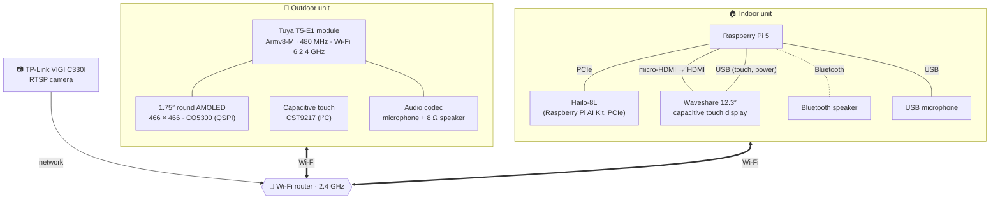

# 🔧 Hardware

[← Back to the README](../README.md)

Two units on your home Wi-Fi: a round touch screen at the door, and a Raspberry Pi 5 with a large touch display
inside. A network camera watches the door; a Bluetooth speaker plays the chime.

---

## 🛎️ Outdoor unit — Waveshare T5-E1 Touch AMOLED 1.75″

A development board built around Tuya's **T5-E1** module with a round AMOLED touch screen, audio and Wi-Fi —
everything a doorbell needs on one board.
Product page: **[waveshare.com/t5-e1-touch-amoled-1.75.htm](https://www.waveshare.com/t5-e1-touch-amoled-1.75.htm)** ·
TuyaOpen board name: `WAVESHARE_T5AI_TOUCH_AMOLED_1_75`.

| | |
|---|---|
| **Processor** | Tuya T5-E1 module: Armv8-M STAR-MC1, up to 480 MHz |
| **Memory** | 640 KB SRAM, 64 KB ROM, 16 MB PSRAM, 8 MB flash |
| **Wireless** | Wi-Fi 6, 2.4 GHz, 802.11 b/g/n/ax (20 / 40 MHz), on-board antenna · Bluetooth LE |
| **Display** | 1.75″ round AMOLED, 466 × 466, 16.7 M colours, 700 cd/m², 100 000 : 1, 178° viewing angle; CO5300 driver over QSPI |
| **Touch** | Capacitive, CST9217 controller over I²C |
| **Audio** | On-board codec (dual ADC, one DAC), microphone, speaker header (MX1.25 2-pin) — an 8 Ω 2 W speaker comes with it |
| **USB** | Type-C with CH342F USB-to-dual-serial (flashing and log) |
| **Buttons** | PWR and KEY (programmable), RESET |
| **Also on board** | Li-ion battery header (MX1.25) with charger, microSD slot, QMI8658 6-axis IMU, PCF85063 RTC, 5 GPIOs on an 8-pin header |

**What the doorbell uses:** the screen and touch, the microphone (doorbell sound and the trial intercom), the
speaker (the chime at the door) and Wi-Fi. It is powered over USB-C; time comes from the network (NTP), so the RTC,
IMU, microSD and battery header are not used.

---

## 🖥️ Indoor unit

### Raspberry Pi 5

Runs everything inside: the dashboard (PySide6 with a Qt Quick home screen on the GPU), the Mosquitto MQTT broker the
doorbell connects to, the camera buffer and recorder, the web app for phones, and offline speech recognition (Whisper).
Raspberry Pi OS (desktop) on the SD card; recordings are stored there too.

### Raspberry Pi AI Kit — Hailo-8L

An M.2 AI accelerator on the Pi 5's PCIe connector. It runs **YOLOv8s** (from Raspberry Pi's `hailo-models` package)
on the camera's picture in about **33 ms a frame**, so the Pi can watch the door all the time for people, animals
and vehicles while its CPU stays free. Used for the red boxes in the Front door view and for motion recording —
see **[Recordings & detection](recordings.md)**.

### Waveshare 12.3″ capacitive touch display

A wide **12.3″ IPS** panel (1920 × 720, 10-point capacitive touch, toughened glass) —
[Waveshare 12.3inch HDMI LCD](https://www.waveshare.com/12.3inch-hdmi-lcd.htm) ·
[wiki](https://www.waveshare.com/wiki/12.3inch_1920x720_LCD).

- **Picture:** HDMI, to the Pi 5's micro-HDMI port (micro-HDMI to HDMI cable or adapter).
- **Touch:** USB to the Pi; it works without drivers on Raspberry Pi OS.
- The dashboard scales itself to the screen, so other sizes work too.

 

### Camera — TP-Link VIGI C330I

Any camera with an RTSP stream works. The VIGI's main stream (1920 × 1080) is used for the live view and
recordings, its small stream for the detector and the web app. **Settings → Camera → Find** discovers it on the
network (ONVIF).

### Speaker and microphone

- **Bluetooth speaker:** the chime, the door's sound in the Front door view, and recordings played back on the wall.
  Paired from **Settings → Speaker**.
- **USB microphone (optional):** for voice commands. The Bluetooth speaker's own microphone is never used for them.

---

## 📶 Network

| Link | How |
|---|---|
| Doorbell ⇄ Pi | Home Wi-Fi, **2.4 GHz** (the T5 has no 5 GHz). MQTT over TLS-PSK, port 8883 |
| Doorbell → Pi, door sound | UDP 5006 while the Pi listens (a press, or the Front door view open) |
| Pi ⇄ doorbell, intercom (trial) | UDP 5004 |
| Camera → Pi | RTSP (TCP 554) |
| Phones → Pi | Web app on port 8080: home network, or anywhere with [Tailscale](https://tailscale.com) |

> **Tips:** reserve the Pi's address in your router (DHCP reservation) so the doorbell always finds it, and keep
> both units off a guest network — guest Wi-Fi stops devices from talking to each other.
