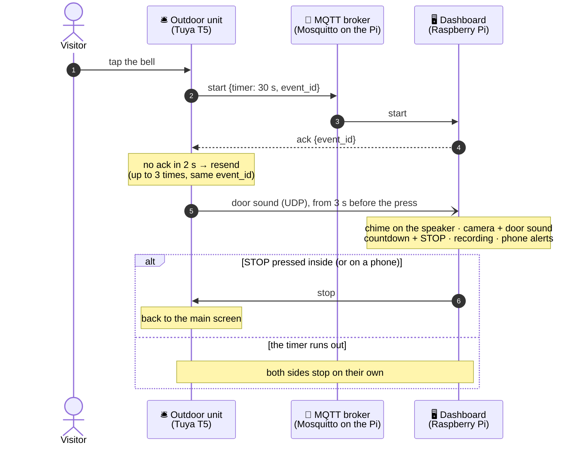

# 📖 Reference

[← Back to the README](../README.md)

## 🔁 How a ring flows



## 📨 MQTT topics

| Topic | Direction | Purpose |
|---|---|---|
| `home/doorbell/start` | outdoor → indoor | Ring, with `timer` and `event_id` |
| `home/doorbell/ack` | indoor → outdoor | Start received (also for duplicates) |
| `home/doorbell/stop` | both ways | Stop ringing |
| `home/doorbell/outdoor/state` | outdoor → indoor (retained) | Doorbell settings and network |
| `home/doorbell/outdoor/online` | outdoor → indoor (retained) | `online` / `offline` (last will) |
| `home/doorbell/outdoor/config` | indoor → outdoor | Change doorbell settings |
| `home/doorbell/outdoor/wifi_scan` | outdoor → indoor | Networks the doorbell can see |
| `home/doorbell/festival` | indoor → outdoor (retained) | Festival theme running now |
| `home/doorbell/talk` | indoor → outdoor | Intercom start / end (UDP 5004); door sound `listen` / `listen_end` (UDP 5006) |

Payloads and rules: **[Indoor/topics.md](../Indoor/topics.md)**.

## 🔒 Security

- **Encrypted doorbell link** — TLS 1.2 with a pre-shared key on port 8883 (ECDHE-PSK-AES128-CBC-SHA256: forward
  secrecy, no certificates, so it works before the doorbell's clock is set). Only a doorbell holding the key can
  connect, and that key may only use `home/doorbell/…` topics. The dashboard connects on `127.0.0.1`, so its traffic
  never leaves the Pi
- **Web access** is off until switched on and needs a password, stored only as a salted scrypt hash in
  `secrets.json`. A login lasts 90 days (HttpOnly cookie); changing the password logs every device out. The page is
  plain HTTP for the home network and Tailscale (encrypted by WireGuard): **do not forward port 8080** on your router.
  With `ufw` on, `setup_pi.sh` allows 8080 from the home network and Tailscale only
- **Ring alerts** are encrypted for each device; Google's, Apple's or Mozilla's push service only passes them on. A
  notification's STOP works only for its own ring. The signing key and the device list stay on the Pi
- **ntfy** — ntfy.sh is reached over HTTPS and sees only the alert text; a self-hosted server is reached over Tailscale
- **Camera login** is kept only in `~/Indoor/secrets.json`, readable by nobody else; it never reaches browsers
- **Detection and speech** run on the Pi; no picture or sound goes to the cloud
- Not encrypted yet: the trial intercom's audio (UDP 5004, off by default) and the door sound (UDP 5006), both on
  the home network only

## 📁 Project layout

```
smart-door-bell/
├── Outdoor/                   TuyaOpen firmware for the round display
│   ├── src/doorbell_ui.c        LVGL screens, bell rendering, touch, settings
│   ├── src/doorbell_net.c       Wi-Fi, NTP clock, MQTT client, remote settings
│   ├── src/doorbell_sound.c     chime, microphone and its 8 s history
│   ├── src/doorbell_listen.c    door sound to the Pi (UDP)
│   └── app_default.config       board: WAVESHARE_T5AI_TOUCH_AMOLED_1_75
├── Indoor/                    Raspberry Pi dashboard (Python, PySide6, Qt Quick)
│   ├── app.py                   window, ring, camera, MQTT, voice
│   ├── home_qml.py · home/      the home screen on the GPU: the looks, widgets, voice orb
│   ├── looks.py                 the looks: colours and type of every page
│   ├── detect.py · watch.py     detection on the Hailo · movement and motion recording
│   ├── recorder.py              camera buffer in RAM, ring and motion clips, storage
│   ├── door_audio.py            the doorbell's sound: receive, sync, play
│   ├── ring_ui.py · events_ui.py · settings_ui.py   visitor screen · events · settings
│   ├── news.py · markets.py     news feeds · NIFTY / SENSEX
│   ├── web.py · webapp.py · web/  web app, its data and actions, ring alerts (push.py)
│   ├── assistant.py             voice commands (Whisper)
│   ├── setup_pi.sh              install / update on the Pi
│   └── assets/                  tones, photos, look previews
├── docs/                      these pages and their pictures
├── sdk/TuyaOpen               the SDK, pinned (submodule)
└── setup.cmd · build.cmd      build and flash the doorbell from Windows
```
