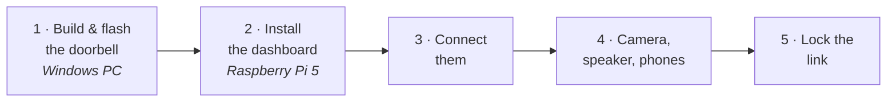

# 🚀 Setup guide

[← Back to the README](../README.md)

Everything comes from this repository: the TuyaOpen SDK is pinned as a submodule (`sdk/TuyaOpen`, the version the
firmware is tested with), and scripts set up both machines.



---

## 1 · The doorbell — on a Windows PC

Needs [Git](https://git-scm.com/download/win). All board, LVGL, touch and font settings are already in
`Outdoor/app_default.config` (board `WAVESHARE_T5AI_TOUCH_AMOLED_1_75`).

```powershell
git clone https://github.com/someshsaraf/smart-door-bell.git
cd smart-door-bell
.\setup.cmd                 # once: the SDK, its build tools and the doorbell's encryption key
.\build.cmd -Flash COM6     # build and flash (port: Device Manager › Ports); add -Monitor to see its log
```

`setup.cmd` / `build.cmd` work from cmd and PowerShell. The first build also downloads the T5 compiler and platform
(a few GB, once). The encryption key is written to `Outdoor\src\doorbell_secret.h` and `Indoor\mqtt_psk.txt` (both
git-ignored); the Pi needs the second file.

Board configuration, logs and troubleshooting: **[Outdoor/README.md](../Outdoor/README.md)**.

## 2 · The dashboard — on the Raspberry Pi 5

Raspberry Pi OS (desktop), with the AI Kit, display, speaker and camera connected (see **[Hardware](hardware.md)**).

```bash
git clone https://github.com/someshsaraf/smart-door-bell.git
scp <pc>:smart-door-bell/Indoor/mqtt_psk.txt smart-door-bell/Indoor/   # the key from the PC
bash smart-door-bell/Indoor/setup_pi.sh
```

`setup_pi.sh` installs the packages (Qt Quick and the fonts included), puts the dashboard in `~/Indoor` —
keeping your settings, camera login and recordings — sets up the encrypted MQTT broker, opens the firewall for the
home network, and starts the dashboard at every boot. To update later: `git pull` and run it again.

> The Hailo runtime and models come with Raspberry Pi's `hailo-all` package for the AI Kit
> (`sudo apt install hailo-all`). Without the AI Kit everything works except the boxes and motion recording.

## 3 · Connect them

On the doorbell's setup screen, join your 2.4 GHz Wi-Fi and set the **indoor unit's address** to the Pi's IP
(`hostname -I` on the Pi). It shows **Connected** within seconds. From then on everything is changed from the
dashboard's **Settings → Outdoor unit** — see [configured from the wall](outdoor.md).

> Reserve the Pi's address in your router (DHCP reservation) so the doorbell never loses it.

## 4 · Camera, speaker, phones

- **Camera:** **Settings → Camera → Find** discovers it (ONVIF names it, e.g. *VIGI C330I*); enter its password,
  **Test connection** (shows a snapshot), **Save**. The login stays only in `~/Indoor/secrets.json` on the Pi
- **Speaker:** **Settings → Speaker** → search, pair, test; then pick a **Bell tone**
- **News:** **Settings → News** — channels, regions, topics
- **Phones:** see **[Phones & web](phones.md)**

## 5 · Lock the link

The doorbell talks to the Pi over **TLS with a pre-shared key** on port 8883. Once it shows *Connected*:

```bash
sudo bash ~/Indoor/tools/setup_mqtt_tls.sh --lock
```

Plain MQTT then only works on the Pi itself. To make a new key later: `python Outdoor/tools/make_psk.py` on the PC,
copy `Indoor/mqtt_psk.txt` to `~/Indoor/`, run `sudo bash ~/Indoor/tools/setup_mqtt_tls.sh`, and flash the doorbell.
